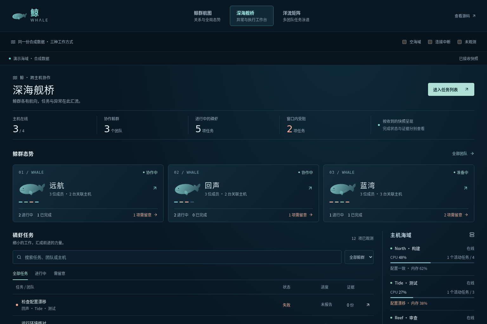

# 🐋 鲸 · Whale

鲸是 DSH 原生多机协作插件：在一个工作区管理 SSH/容器和 Instabox Host、任务派发与证据、
会话、Room / AgentTeams / AgentBus 桥接、配置检查和可选终端。

当前版本：**0.2.0-beta.13**，MIT。

[下载预构建包与校验值](https://github.com/muyi123567/dsh-fusion-public/releases/tag/v0.2.0-beta.13)。

## 安装

从本仓库 Releases 下载预构建包与 SHA256SUMS，校验后安装到 Web profile：

~~~sh
dsh plugin --profile web add ./dsh-fusion-0.2.0-beta.13.tgz
~~~

重载 profile 后打开侧栏 Fusion。包已包含 host、客户端与类型声明；
运行依赖仍需要网络或已有缓存。companion 安装、配置、升级与回滚见
[插件说明](packages/plugin/README.md)。

| 运行要求 | 版本 |
| --- | --- |
| Node.js | >=24.9.0 |
| DSH 安装范围 | >=0.2.0-rc.2 <0.3.0 |
| 推荐宿主 | 0.2.2-rc.1 |
| 候选宿主 | 0.2.2-rc.3，范围与证据见发布说明 |
| AgentTeams companion | 0.1.30 |
| Room / AgentBus | 0.7.0 / 0.1.1（兼容补丁版） |

安装范围不等于所有组合均已通过业务验收。

## 鲸入深海 · 动态原型

[打开实时动态预览](https://whale-panel.whale-muyi123567.workers.dev/)。
使用 Grab3D CC0 纹理座头鲸与 Three.js，实时呈现摆尾、头先下潜、水面波光、光束和气泡。
支持播放、暂停、重播、进度拖动、手机取景与减动画；素材随项目分发，不依赖第三方运行时下载。

这是独立的视觉原型，保留返回舰桥入口；安装包仍为 beta.13，原有插件不会加载 3D 场景。
[实现与检查记录](docs/design/2026-11-16-whale-dive.md) ·
[模型来源与许可](packages/client/public/whale-assets/CREDITS.md)

## 深海面板

鲸群代表团队；一项项细任务与子代理像磷虾，支撑团队前进。团队与主机各自保留
真实身份，面板只展示已经观测到的关系，不补造跨团队连线或任务。

正式首页采用「深海舰桥」：团队态势、异常优先任务、主机资源与证据入口。
手机先显示任务，再显示团队卡。连接、权限、来源缺失与陈旧状态明确提示。
对比展厅保留三个用代码实现的方向：
- 鲸群航图：团队探索与任务关联。
- 深海舰桥：日常多机运维。
- 洋流矩阵：跨团队的任务状态扫描。

[打开三版交互展厅](https://whale-panel.whale-muyi123567.workers.dev/design-gallery.html) ·
[比选与审查记录](docs/design/2026-11-16-whale-comparison.md)

本版统一鲸品牌与深海配色，保留原有任务、会话、配置、终端和安全边界。
展示模型按真实 ID 关联，保留未观测任务声明，区分父/子任务主机负载，
并单独表示受阻、待验收与完成。前端样式限定插件内部，支持键盘与减动画。
npm 包名、工具与路由继续使用 dsh-fusion，既有安装与接入保持兼容。

## 验收边界

模型写入和远程终端默认关闭，凭据仅在宿主解析。
Host owner 声明不能替代系统账号隔离或成员级 ACL；writeScopes 只是提示。
跨 Host fencing 租约、独立 reviewer 绑定代码版本和候选补丁自改进仍未交付。
真实模型任务、完整多 Session 协作、第三台节点和升级恢复矩阵仍待独立验收。

最新结果与包哈希见 [发布说明](docs/releases/2026-11-16-beta13.md)。
[公开来源](PUBLICATION.md)解释本仓库如何排除私人运维历史。

## 开发

~~~sh
pnpm install --frozen-lockfile
pnpm typecheck
pnpm test
pnpm --filter dsh-fusion build
node scripts/doctor.mjs
pnpm --filter dsh-fusion test:package
pnpm test:e2e
pnpm audit --json
~~~

使用已授权的隔离环境验证。
[扩展文档](docs/extensions/task-views.md) · [贡献指南](CONTRIBUTING.md) ·
[安全政策](SECURITY.md) · [项目状态](docs/project/status.md)。
