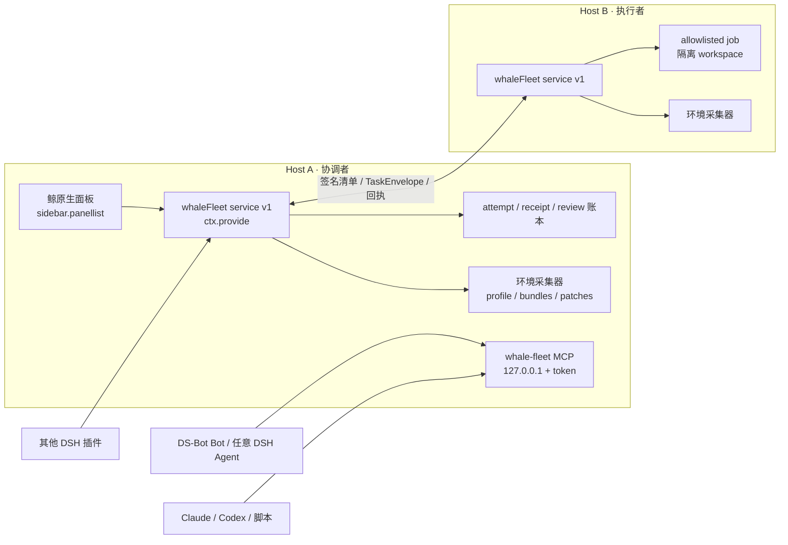

# 鲸群：开放的多机 DSH 协作与环境一致性

状态：产品与接口设计提案，不是发布声明。基线 `dsh-fusion` `db0cfad` / beta.14，
调研依据见 [DSH 高质量项目代码级调研](../research/2026-11-22-dsh-quality-projects.md)。

## 0. 一句话

鲸群是 DS-Bot 式“长期 Bot 团队”在**多台 DSH 主机**上的另一种实现：任务与对话仍属于
DSH/DS-Bot 自己的 Session，鲸只负责“在哪台机器执行、环境是否一致、交付了什么证据”，
并把这三件事以**版本化服务、MCP 工具、标准槽位和公开 Schema** 开放给其他插件。

## 1. 为什么现在做

鲸当前已经具备生态里稀缺的闭环：任务 revision 绑定、单 attempt 隔离工作区、材料 v2 回执、
Ed25519 签名复核、过期判定、离线验签。但它有三个结构性缺口：

1. **只有鲸自己能调用。** 能力藏在面板和私有 HTTP 路由里，没有 `ctx.provide` 服务，
   其他 DSH 插件无法以稳定方式复用。
2. **只有 Agent 能看，不能做。** 没有 MCP 工具面，DS-Bot 的 Bot、Claude Desktop、Cursor、
   Codex 或用户脚本无法把“查主机 / 查漂移 / 发起一次待审批派发”交给鲸群。
3. **执行证据缺环境维度。** 回执绑定了代码、输入、运行时、配置和产物，但没有绑定“这台
   主机当时的 DSH 组合是否与目标任务要求一致”，因此跨机复现仍靠人记忆。

与此同时，生态里的同类插件集中在远程切换、SSH/VPS 运维、NAT 入网和纯消息协作，没有
“环境一致性 + 执行证据”这一层。鲸群应占据这个空位，而不是再做一套 SSH 面板或消息总线。

## 2. 产品定位

### 2.1 与 DS-Bot 的关系

| 维度 | DS-Bot | 鲸群 |
| --- | --- | --- |
| 基本单位 | Bot = 一个 DSH root Session | Host = 一台 DSH；Bot/Session 仍由 DSH/DS-Bot 持有 |
| 协作轴 | 同一台电脑上的 Bot 团队、群聊、Bot-to-Bot | 多台主机上的任务派发、环境校验、证据回流 |
| 外部入口 | 本机 MCP（7 个消息工具） | 本机 MCP（主机/环境/任务状态；派发需审批） |
| 远程链路 | 手机/浏览器 E2E Relay | 复用现有 SSH/FleetRouter；NAT 中继为后续可选 |
| 权威状态 | 团队元数据在插件文件，对话在 DSH Session | 任务在 DSH 上游，鲸只存 attempt/回执/复核关联 |
| 核心差异 | 让 Bot 像人一样长期协作 | 让 Bot 团队跨机器工作且环境可复现 |

鲸群不是“另一个 DS-Bot”，而是 DS-Bot 团队的**跨机执行与一致性层**。两者可以同时安装：
DS-Bot 的 Bot 通过同 profile 的 MCP 工具直接使用鲸群，不需要改 DS-Bot 代码。

### 2.2 三个产品承诺

1. **同一套协作语义。** 不新增“鲸群任务”这一权威；任务仍来自 DSH Session/Goal/Team。
2. **环境可解释。** 每台主机发布签名环境清单；任务可要求环境摘要；漂移可见、可门禁。
3. **开放可接入。** 其他插件通过版本化服务接入；外部 Agent 通过 MCP 接入；UI 通过标准槽位接入。

## 3. 用户场景

### 场景 A：Chief 在 A 机，把验证任务交给 B 机

1. 用户在 A 机对 Chief Bot 说：“在 B 机跑 revision 的验证，要求和 A 机同环境。”
2. Chief 调用 `whale_list_hosts` 与 `whale_environment_diff`，发现 B 机缺一个 bundle 版本。
3. Chief 不直接派发，而是创建“待审批派发”；用户在鲸面板看到漂移项并选择“先对齐/仍然派发”。
4. 派发成功后，B 机的 attempt 回执带回 `environmentDigest`；A 机复核人能离线验证
   签名、回执和当时环境。

验收：漂移项必须来自真实清单；未审批不得执行；回执的环境摘要必须与派发时要求一致。

### 场景 B：两台机器上的 Bot 团队共享同一份环境标准

1. 管理员在 `fleet.lock.json` 固定 DSH 版本范围、bundle 版本、关键 patch 摘要。
2. 每台主机启动后发布清单；协调者生成漂移报告。
3. 没有漂移的主机显示“可接单”；有阻塞级漂移的主机显示原因与修复建议，不自动改配置。

验收：报告只读、可重复；修复必须经 `ctx.pluginManager` 的显式操作与用户批准。

### 场景 C：外部 Agent 查询而不放权

Claude Desktop / Codex 通过本机 MCP 令牌调用 `whale_task_status`、`whale_receipt`；
它能读取状态，但不能导入复核、不能改设置、不能读密钥、不能直接执行命令。

验收：未授权请求 401；浏览器 Origin 请求 403；任何写操作不出现在 MCP v1 工具列表。

## 4. 设计原则

1. **不建第二权威。** 任务、成员、会话属于 DSH；鲸只保存 attempt、回执、复核和环境观测。
2. **默认关闭、默认本地、默认只读。** 新接口逐项开启；MCP 只监听 loopback；v1 不暴露管理写。
3. **契约先行。** 服务、工具、事件、Schema 都有版本号；未知字段忽略，未知版本拒绝。
4. **生命周期绑定。** 所有注册通过 `ctx.effect` / `ctx.provide` / `mcpManager.register`，
   插件卸载即撤销。
5. **证据不等于成功。** 签名有效、退出码 0、环境匹配都只证明各自的事实，不自动等于验收通过。
6. **人类保留权力。** 审批、密钥、设置、建删 Bot、改权限永远留在本机人类侧。

## 5. 架构



组件职责：

- **环境采集器**：只读 `ctx.pluginManager`、`ctx.profileContext`、profile 文件与运行时信息，
  生成可复现的 `FleetHostManifest`。
- **Fleet 服务**：对插件提供 v1 服务；对客户端提供现有 HTTP 路由；对 Agent 提供 MCP 工具。
- **账本**：沿用现有 attempt/receipt/review 存储，新增环境摘要字段。
- **面板**：继续使用 `sidebar.panellist` / `main`，并通过 `plugins.detail.section` 在插件页
  展示本机漂移。

## 6. 四个原生接入面

### 6.1 插件到插件：`whaleFleet` 服务

```ts
export const inject = ['mcpManager', 'pluginManager', 'profileContext', 'sessions', 'connection']

ctx.provide('whaleFleet', Object.freeze({
  contractVersion: 1,
  manifest: () => collectManifest(ctx),
  listHosts: () => fleet.listHosts(),
  diff: (hostId, expectedDigest) => fleet.diff(hostId, expectedDigest),
  dispatch: envelope => fleet.dispatch(envelope),
  attempt: attemptId => fleet.attempt(attemptId),
  receipt: attemptId => fleet.receipt(attemptId),
  subscribe: listener => fleet.subscribe(listener),
}))
```

消费方纪律（与 dsh-im 一致）：

- `inject: ['whaleFleet']`，先检查 `contractVersion === 1`；
- provider 卸载后，旧引用返回 `undefined` / 抛 `whale/unavailable`，不缓存状态；
- 只通过服务调用，不直接读写鲸的存储文件；
- 写操作必须带 `requestId` 与审批结果。

### 6.2 Agent 到工具：MCP

用 `ctx.mcpManager.register('whale-fleet', entry)` 注册（`0.2.3-alpha.2` 源码已提供；
实际可用版本以宿主与 profile 是否挂载 `mcp-manager` 为准）：

```ts
ctx.mcpManager.register('whale-fleet', {
  transport: 'stdio',
  command: process.execPath,
  args: [mcpEntry, '--host', hostId],
})
```

也可由插件自己起本机 HTTP MCP（兼容旧宿主），规则照抄 DS-Bot：

- 默认关闭；只监听 `127.0.0.1`；只接受 POST；无 MCP 会话；
- 有 `Origin` 头即 403；Host 必须本机；Bearer token 只存 SHA-256；
- 每客户端可撤销、可限权；v1 只提供只读工具 + 待审批派发请求。

MCP v1 工具：

| 工具 | 作用 | 权限 |
| --- | --- | --- |
| `whale_list_hosts` | 列出已知主机、在线/漂移/可接单 | 读 |
| `whale_host_manifest` | 返回指定主机清单（可选字段裁剪） | 读 |
| `whale_environment_diff` | 与期望摘要比较，返回漂移项 | 读 |
| `whale_task_status` | 任务/attempt 当前状态 | 读 |
| `whale_receipt` | 回执与验签摘要（不含文件内容） | 读 |
| `whale_request_dispatch` | 创建待审批派发意图 | 写，但必须本机面板批准 |

不提供：导入复核、改设置、读密钥、建删 Bot、执行任意命令。

### 6.3 客户端到宿主：HTTP + Typert Remote

- 保留 `/plugins/dsh-fusion/tasks/execution` 等现有路由，作为 v1 兼容面。
- 新增只读 Remote 命名空间 `ctx.remote.whale`（`manifest` / `listHosts` / `diff` /
  `attempt` / `receipt`），用 `@Remote` 生成类型化客户端契约。
- 写操作继续走同源 mutation + JSON + DSH 认证，不因 Remote 化而放宽。

### 6.4 UI 到宿主：标准槽位

- `sidebar.panellist`：鲸主面板（已有）。
- `plugins.detail.section`：在“插件详情”里显示本机环境摘要与漂移计数。
- `settings.section`：环境策略、MCP 访问开关、客户端令牌管理。
- 不直接操作宿主 DOM；窄容器由宿主决定全屏或推挤。

## 7. 核心对象

机器可读定义在同目录 `contracts/`：

- [`fleet-manifest.v1.schema.json`](contracts/fleet-manifest.v1.schema.json)
- [`drift-report.v1.schema.json`](contracts/drift-report.v1.schema.json)
- [`task-envelope.v1.schema.json`](contracts/task-envelope.v1.schema.json)

### 7.1 `FleetHostManifest v1`

只包含可公开比对的事实，不含密钥、令牌、私钥、完整命令或用户隐私路径。

- 身份：`hostId`（主机公钥派生，`sha256:<64hex>`）、`displayName`、`observedAt`。
- 运行时：DSH 版本、profile 名、Node 版本、平台、架构。
- 组合：bundle 列表（名称/版本/启用/可用性/来源/行 id/错误）、profile/home patch 摘要、
  兼容豁免。
- 能力：SSH/Instabox/GPU/终端等布尔或枚举能力。
- 工作区：根路径摘要（不是明文路径）、VCS commit、dirty 标记、输入摘要。
- 工具面：MCP 服务器名称/传输/配置摘要（不含凭据）。
- 提供方：模型 provider 名称；密钥只记录 `present` 名称。
- 摘要：`environmentDigest` 覆盖 L0–L2；`secretPresenceDigest` 单独覆盖 L3 的存在性。

签名：`signature { alg: "ed25519", keyId, value }`，对“去掉 `signature` 与 `observedAt` 的
规范化 JSON”签名。`environmentDigest` 同样排除 `observedAt` 与 `signature`。

### 7.2 环境分层与摘要

| 层 | 内容 | 是否进入 environmentDigest |
| --- | --- | --- |
| L0 运行时 | DSH 版本、Node 主版本、平台、架构 | 是 |
| L1 组合 | 有序 bundle + 版本 + 启用状态 + patch 摘要 + 行 id | 是 |
| L2 工作区 | 仓库 commit、dirty、输入/配置摘要 | 是 |
| L3 凭据 | 密钥名称的存在性、provider 名称 | 否，单独 `secretPresenceDigest` |

规范化：对象键排序、无空白、UTF-8、数字用 JSON 规范形式；数组保持声明顺序（bundle 顺序有语义）。
`observedAt`、进程 pid、端口、内存、CPU、临时路径不进入摘要。

### 7.3 `DriftReport v1`

```json
{
  "contractVersion": 1,
  "hostId": "sha256:...",
  "expectedDigest": "sha256:...",
  "observedDigest": "sha256:...",
  "overall": "drift",
  "items": [
    {
      "code": "bundle.version",
      "severity": "block",
      "path": "bundles[dsh-fusion].version",
      "expected": "0.2.0-beta.15",
      "actual": "0.2.0-beta.14",
      "remedy": "在目标主机升级到锁定版本并重启 profile"
    }
  ]
}
```

严重级别：

| 级别 | 含义 | 典型项 |
| --- | --- | --- |
| `block` | 不允许按该环境派发 | DSH 版本不兼容、必需 bundle 缺失/禁用、锁定 patch 不符、工作区 commit 不符、必需能力缺失 |
| `warn` | 可派发但需知情 | 可选 bundle 版本差、额外 bundle、provider 名称不同、MCP 服务器缺失、OS 不同 |
| `info` | 仅展示 | 显示名、观测时间、非语义字段 |

`overall` 只有 `match` / `drift` / `unknown`；来源不可读、签名无效、清单过期都归 `unknown`，
不能当作 `match`。

### 7.4 `TaskEnvelope v1`

- 上游任务：`taskId`、`taskRevision`、`sourceToken`；鲸不复制任务正文作为权威。
- 幂等：`requestId`、`idempotencyKey`。
- 目标：`hostId` 或选择器（能力/标签），但一次 attempt 只绑定一个 host。
- 环境：`requireDigest`、`policy: exact | compatible`、`requiredCapabilities`。
- 作业：只引用 allowlisted `jobId`，不携带任意命令。
- 材料：code/input/runtime/config/artifact 的 pin。
- 限制：deadline、最大输出字节、审批要求。

### 7.5 回执扩展

现有 v1/v2 回执保持兼容；新增可选 `environment`：

```json
{
  "environment": {
    "manifestDigest": "sha256:...",
    "observedDigest": "sha256:...",
    "matched": true,
    "policy": "exact",
    "signatureKeyId": "host:..."
  }
}
```

`matched` 只表示“派发时要求的环境与执行时观测一致”，不表示任务成功。

### 7.6 `BotPeer v1`（可选适配）

```json
{
  "kind": "ds-bot",
  "hostId": "sha256:...",
  "mcp": { "url": "http://127.0.0.1:8797/mcp", "credentialRef": "credential:DSBOT_MCP_TOKEN" },
  "bots": [{ "id": "...", "name": "Chief", "role": "..." }]
}
```

令牌只存 credential 引用。没有 DS-Bot 公开服务时，不解析其私有 `state.json`。

## 8. 环境一致性方案

### 8.1 采集

只读来源：

1. `ctx.pluginManager.listBundles()`：名称、版本、启用、安装、可用性、来源、行、错误。
2. `ctx.profileContext`：profile 位置、启动 bundle 名、补丁 overlay 路径。
3. profile 目录：`package.json`、`cordis.patch.yml`、`compatibility.json`、锁文件摘要。
4. 运行时：`process.version`、`platform`、`arch`、DSH 版本。
5. 工作区：`ctx.workspaceRegistry` / `ctx.workingDirectory`；VCS 信息由只读命令或作业提供。
6. 能力：只探测服务是否存在，不调用有副作用的接口。

采集失败必须返回 `unknown` 与原因，不得用默认值伪装成匹配。

### 8.2 交换

- **拉取**：协调者通过现有 SSH/FleetRouter 或已认证 HTTP 读取对方清单。
- **推送**：主机在组合变化后去抖发布；事件 `whale/manifest-changed`。
- **缓存**：离线清单带 `observedAt` 与 `staleAfter`；过期只用于展示，不用于门禁。
- **签名**：主机私钥只在本机；协调者维护 `hostId -> publicKey` 的 TOFU/固定信任表。

### 8.3 策略

```yaml
whale:
  environment:
    mode: advisory | gate | reconcile
    defaultPolicy: compatible
    lockFile: /var/lib/dsh-fusion/fleet.lock.json
    staleAfterSeconds: 900
    allowSources:
      - registry:npmjs
      - github:muyi123567/*
    requireApprovalFor:
      - install
      - update
      - remove
      - restart
```

- `advisory`（默认）：只报告，不影响派发。
- `gate`：`TaskEnvelope` 要求 `exact` 时，`block` 级漂移直接拒绝；`compatible` 只拒绝
  明确不兼容项。
- `reconcile`：生成计划，逐项调用 `ctx.pluginManager` 的安装/更新/启用接口；每步需批准，
  失败保留现场并可回滚；绝不改密钥、绝不覆盖用户 patch 内容。

### 8.4 发布与回滚

1. 生成新的 `fleet.lock.json`（期望清单 + 允许来源 + 策略）。
2. 先在一台 canary 主机应用；重新采集并比对摘要。
3. 摘要匹配后扩大；任何 `block` 漂移停止扩散。
4. 回滚使用上一份 lock 与插件管理器安装记录；不删除用户数据。

### 8.5 明确不同步

- 不同步密钥、令牌、OAuth grant、cookie。
- 不同步会话正文、任务正文、Bot 私有状态。
- 不同步用户本地 patch 的完整内容；只比对锁定条目的摘要。
- 不在未经批准时自动安装、升级、删除或重启。

## 9. 与 DS-Bot 的三种协作模式

### 模式 A：同 profile 工具（默认，零改动）

DS-Bot 的 Bot 是 DSH root Session，自动看到同 profile 的 MCP 工具。安装鲸并启用
`whale-fleet` MCP 后，Chief Bot 可直接调用 `whale_list_hosts`、`whale_environment_diff`、
`whale_request_dispatch`。这是最快、最稳的互操作方式。

### 模式 B：BotPeer（可选）

鲸把 DS-Bot 的本机 MCP 当作一个“Bot 通道”：读取 `list_bots`，把 Bot 展示为可派发对象，
通过 `send_to_bot` / `wait_for_reply` 传递消息。令牌走 credential 引用；不读私有文件。

### 模式 C：跨机 Bot 团队（后续）

在每台主机安装 DS-Bot + 鲸；Chief 在 A 机，Worker Bot 在 B 机。鲸负责把“给 B 机某个 Bot
的任务”转成一次跨机派发，并把 B 机 Bot 的回复作为消息回传。需要 DS-Bot 暴露稳定服务或
继续使用其 MCP；不以修改 DS-Bot 为前提。

## 10. 生态兼容矩阵

| 项目 | 接入方式 | 鲸提供什么 | 鲸不做什么 |
| --- | --- | --- | --- |
| DS-Bot | 同 profile MCP 工具；可选 BotPeer | 主机/环境/派发/回执工具 | 不复制 Bot 团队 UI，不读 `state.json` |
| dsh-im | 服务调用 + 标准槽位 | 环境/漂移服务；面板嵌入 | 不接管 IM 通道 |
| dsh-qqbot | 服务调用 | 同上 | 不复制 QQ 机器人能力 |
| dsh-fleet / Constellation / WispOps | 互补 | 任务证据与环境摘要 | 不做通用 SSH 面板/密码库 |
| dsh-anywhere | 互补 | 环境校验与回执 | 不做 NAT 入网（后续可配） |
| 任意 DSH 插件 | `inject: ['whaleFleet']` | v1 服务 | 不要求改宿主 |

## 11. 安全模型

| 威胁 | 控制 |
| --- | --- |
| 本机其他程序偷令牌 | 令牌只显示一次、只存 SHA-256、可撤销、按客户端限权 |
| 浏览器 CSRF / DNS rebinding | 有 `Origin` 即拒绝；Host 必须 loopback；只接受 POST |
| 恶意/伪冒主机 | 清单 Ed25519 签名；`hostId` 由公钥派生；TOFU + 固定信任表 |
| 重放旧清单/回执 | `observedAt`、`requestId`、幂等键、过期判定 |
| 越权派发 | MCP v1 不直接执行；派发意图需本机面板批准；作业 allowlist |
| 借鲸读密钥 | 清单只记录名称存在性；MCP 不返回凭据；日志脱敏 |
| 供应链替换 | `allowSources` + 版本/摘要锁定 + plugin-manager 兼容检查 |
| 恶意插件调用服务 | 服务调用仍受 DSH 插件信任边界；写操作带审批与审计 |
| 跨机中间人 | SSH 主机密钥校验；HTTP 面仅 loopback；后续中继端到端加密 |

## 12. API 规格（v1）

### 12.1 `whaleFleet` 服务

```ts
interface WhaleFleetServiceV1 {
  readonly contractVersion: 1
  manifest(): Promise<FleetHostManifest>
  listHosts(): Promise<FleetHostSummary[]>
  host(hostId: string): Promise<FleetHostManifest | undefined>
  diff(hostId: string, expectedDigest?: string): Promise<DriftReport>
  dispatch(envelope: TaskEnvelope): Promise<{ attemptId: string; state: string }>
  attempt(attemptId: string): Promise<AttemptView | undefined>
  receipt(attemptId: string): Promise<ExecutionReceipt | undefined>
  subscribe(listener: (event: WhaleFleetEvent) => void): () => void
}
```

错误码：`whale/unavailable`、`whale/invalid-input`、`whale/host-unknown`、
`whale/environment-drift`、`whale/approval-required`、`whale/source-stale`、
`whale/store-unavailable`。

### 12.2 MCP 工具参数

| 工具 | 参数 | 返回 |
| --- | --- | --- |
| `whale_list_hosts` | 无 | 主机摘要数组 |
| `whale_host_manifest` | `hostId`, `sections?` | 裁剪后的清单 |
| `whale_environment_diff` | `hostId`, `expectedDigest?` | `DriftReport` |
| `whale_task_status` | `taskId` 或 `attemptId` | 状态与最近时间 |
| `whale_receipt` | `attemptId` | 回执摘要、签名校验结果、环境摘要 |
| `whale_request_dispatch` | `TaskEnvelope` | `{ intentId, approval: "pending" }` |

所有工具返回结构化 JSON；错误用 `isError: true` 与稳定错误码，不泄露内部路径。

### 12.3 事件

- `whale/manifest-changed`：本机清单变化（组合、能力、工作区）。
- `whale/drift`：某主机漂移级别变化。
- `whale/attempt-changed`：attempt 进入 reserved/sent/completed/unconfirmed。

事件只携带 id、摘要与级别；消费方需要详情时回调服务读取，避免事件体成为第二权威。

## 13. 路线图与验收

### M0：契约与文档（本文件）

- 发布三份 JSON Schema 与研究/产品文档。
- 验收：Schema 可被 `python3 -m json.tool` 解析；文档链接可解析；无密钥。

### M1：只读环境清单与漂移

- 实现 `whaleFleet.manifest()` / `listHosts()` / `diff()`；面板展示本机摘要；
  `plugins.detail.section` 显示漂移计数。
- 不改变派发行为。
- 验收：固定 fixture 下摘要稳定；缺字段/读失败为 `unknown`；单测覆盖排序与排除字段。

### M2：MCP 只读 + DS-Bot 互操作

- 启用本机 MCP 只读工具；按 DS-Bot 规则做 Origin/Host/token 检查。
- 在安装 DS-Bot 的隔离 profile 中，让 Chief Bot 调用 `whale_list_hosts` 并返回结果。
- 验收：未授权 401、浏览器 403、读工具成功；写工具不存在。

### M3：环境门禁派发与回执绑定

- `TaskEnvelope` 支持 `requireDigest`；回执写入 `environment`；复核脚本校验。
- 验收：漂移主机被拒绝；匹配主机成功；回执摘要可离线重算；不匹配时状态为未确认。

### M4：计划式对齐与回滚

- `reconcile` 模式生成计划，调用 plugin-manager，逐项批准；失败回滚。
- 验收：dry-run 不写盘；未批准不执行；失败后清单不变；回滚可复现。

### M5（可选）：NAT/中继与多协调者

- 仅在有真实需求和授权时评估；不承诺时间表。

## 14. 非目标

- 不做第二套任务调度器、消息总线、团队数据库或 SSH 面板。
- 不自动同步密钥、会话正文、Bot 私有状态。
- 不在默认配置下监听公网、不默认开启 MCP、不默认允许写操作。
- 不把“环境匹配”“签名有效”“退出码 0”宣传为任务成功。
- 不修改 DS-Bot 或 DSH 宿主来换取集成。

## 15. 开放治理

- **服务契约**：`contractVersion` 整数；v1 内只做加法；删除/改义必须升 major。
- **包版本**：遵循 semver；DSH 兼容范围写入 `dsh.compatibility`。
- **Schema**：`contracts/` 下按 `*.v1.schema.json` 发布；`additionalProperties: false`
  只用于本地生成，消费方必须忽略未知字段。
- **弃用**：至少提前两个 minor 版本标注；清单中带 `deprecated` 与替代项。
- **贡献**：接口变更需附带失败案例、权限边界、测试与迁移说明；不接受“竞品有”作为理由。
- **中立性**：契约以 MIT 发布，任何插件可实现或消费，不绑定单一市场或托管服务。

## 16. 验收边界

本文是设计提案。除已注明的现有实现外，环境清单、漂移、MCP 工具、环境门禁与回执扩展都尚未
交付。任何“可用”结论都必须有新鲜测试输出与至少一次真实宿主验证；本地 fixture、构建成功、
进程退出码 0 都不等于多机业务验收。
